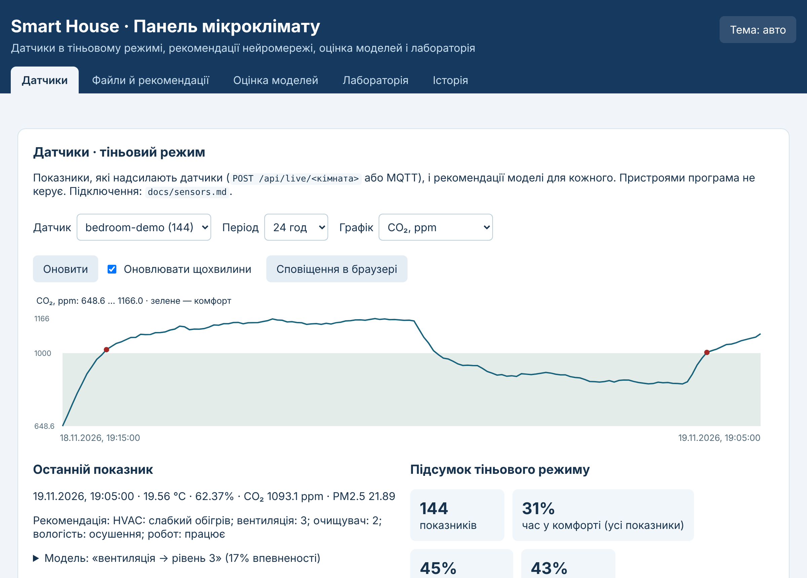
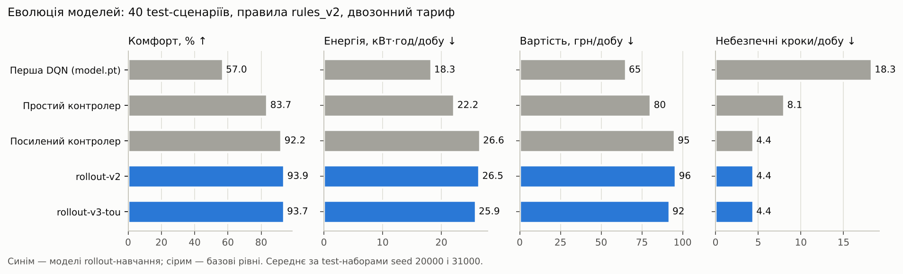
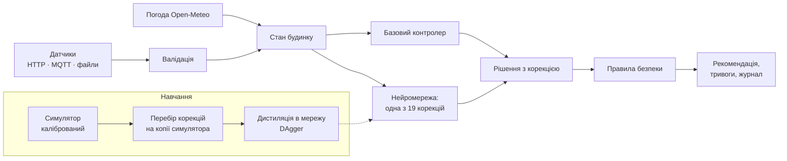

# Smart House · агентна система керування мікрокліматом

[](https://github.com/Lowckick/ai_house_model/actions/workflows/tests.yml)

[](LICENSE)

Система радить, як керувати опаленням, вентиляцією, очищувачем повітря, зволожувачем і
роботом-пилососом, щоб у будинку було комфортно, безпечно й без зайвих витрат енергії.
Рішення приймає **гібридна політика**: детермінований контролер дає базове рішення,
нейромережа обирає одну з 19 корекцій, а правила безпеки застосовуються останніми.
Реальні датчики підключаються в **тіньовому режимі**: система лише радить і журналює.

<picture>
  <source media="(prefers-color-scheme: dark)" srcset="docs/images/panel-sensors-dark.png">
  
</picture>

## Швидкий старт

```bash
pip install torch --index-url https://download.pytorch.org/whl/cpu
pip install -r requirements.txt
python main.py web --demo          # панель із демо-даними: http://127.0.0.1:8000
```

`--demo` заповнює окрему базу добою показників двох симульованих кімнат, імпортом і
порівнянням моделей. Без нього: `python main.py web --weather open-meteo`.
Або в Docker: `docker compose up -d --build` ([docs/docker.md](docs/docker.md)).

## Що вміє

- **Рекомендації** для показників із файлів (JSON/CSV/TXT) і з живих датчиків (HTTP, MQTT, Home Assistant, ESP32) з поясненням: базове рішення, корекція мережі та її впевненість, зміни правил.
- **Тривоги** про CO₂, PM2.5, температуру й вологість у браузері та Telegram.
- **Реальна погода** Open-Meteo для кожного показника й **двозонний тариф** у вартості.
- **Калібрування** симулятора за записами датчиків і перенавчання моделі під свій будинок.
- **Відтворювані експерименти**: відбір лише на validation, парна оцінка на test, звіти JSON.
- **Вебпанель** з п'ятьма вкладками, світлою й темною темами; лабораторія для порівняння моделей.

## Результати

<picture>
  <source media="(prefers-color-scheme: dark)" srcset="docs/images/models-dark.png">
  
</picture>

- Нейромережа, навчена rollout-методом, на 40 test-сценаріях: **комфорт 93,8 % проти 92,2 %** у посиленого контролера, енергії на 1 кВт·год/добу менше, небезпечних кроків не більше.
- На **п'яти різних будинках** мережа краща навіть за правила, перепідібрані під кожен будинок, у **192 з 200** сценаріїв і переноситься між будинками без перенавчання.
- Перша DQN-модель не перевершила контролер. Цей результат збережено й пояснено.

Детально з таблицями: [docs/results.md](docs/results.md).

## Як це працює



## Команди

| Команда | Що робить |
| --- | --- |
| `web [--demo] [--weather open-meteo]` | вебпанель; приймає живі показники датчиків |
| `import-data` / `validate-data` | рекомендації для файла показників / лише перевірка |
| `mqtt`, `shadow-report` | підписка на датчики MQTT; звіт тіньового режиму |
| `calibrate` | параметри будинку з записів датчиків |
| `train --method rollout` | навчання моделі (`--house`, `--physics`, `--reward`) |
| `evaluate`, `adapt` | парна оцінка; експеримент з адаптацією до будинків |
| `figures` | графіки результатів у `docs/images` |
| `simulate`, `demo`, `report`, `screenshots` | термінальний дашборд і звіти першої версії |

Повний список параметрів: `python main.py <команда> --help`.

## Документація

Зміст і маршрути «що читати для чого»: [docs/README.md](docs/README.md).
Історія версій моделей: [CHANGELOG.md](CHANGELOG.md).
Магістерська робота, що описує систему: [docs/master-thesis](docs/master-thesis/README.md).

Усі кількісні результати отримано в симуляторі; економія чи безпека реального будинку
ними не доведена. Натурна перевірка передбачена через тіньовий режим і калібрування.

## Ліцензія

[MIT](LICENSE) © 2026 Ярослав Головко
