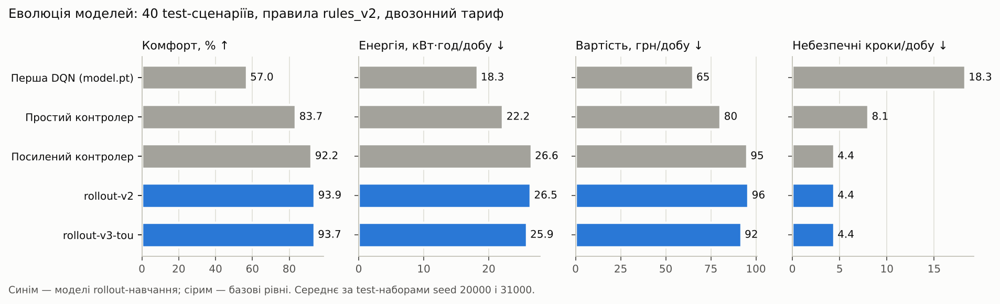
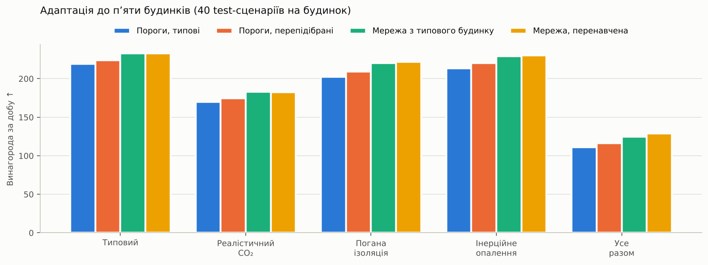
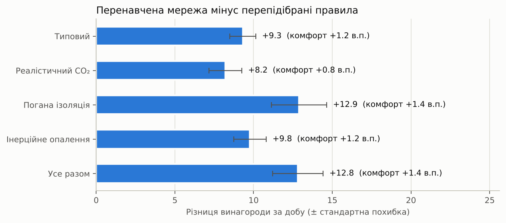

# Результати

Короткий огляд усіх експериментів. Кожен графік має таблицю з тими самими числами.
Графіки відтворюються командою `python main.py figures` з опублікованих звітів.
Усе отримано в симуляторі; відбір моделей — лише на validation, оцінка — один раз на test.

## 1. Еволюція моделей

<picture>
  <source media="(prefers-color-scheme: dark)" srcset="images/models-dark.png">
  
</picture>

Середнє за 40 test-сценаріями (seed 20000 і 31000), правила `rules_v2`, двозонний тариф.
Джерело: [`data/models/rollout-v3-tou-evaluation.json`](../data/models/rollout-v3-tou-evaluation.json).

| Політика | Комфорт, % | кВт·год/добу | Вартість, грн/добу | Небезпечні кроки/добу |
| --- | ---: | ---: | ---: | ---: |
| Перша DQN (`data/model.pt`) | 57.0 | 18.3 | 65.1 | 18.3 |
| Простий контролер (= `improved-v2`) | 83.7 | 22.2 | 80.5 | 8.1 |
| Посилений контролер | 92.2 | 26.6 | 95.2 | 4.4 |
| `rollout-v2` | 93.9 | 26.5 | 95.9 | 4.4 |
| `rollout-v3-tou` | 93.7 | 25.9 | 91.9 | 4.4 |

- Перша DQN економила енергію ціною комфорту й безпеки; друга гібридна (`improved-v2`)
  повністю повторювала простий контролер (див. [training-results.md](training-results.md)).
- Rollout-навчання над посиленим контролером додало +1,7 в.п. комфорту без додаткової
  енергії; тарифна версія на 3–5 % дешевша за `rollout-v2`.
- Більшу частину відриву від простого контролера дає посилений базовий контролер.

## 2. Адаптація до різних будинків

<picture>
  <source media="(prefers-color-scheme: dark)" srcset="images/adaptation-dark.png">
  
</picture>

Сумарна винагорода за добу, середнє двох test-наборів по 20 сценаріїв.
Джерело: [`results/adaptation-2026-11-18.json`](results/adaptation-2026-11-18.json), опис — [adaptation.md](adaptation.md).

| Будинок | Пороги типові | Пороги перепідібрані | Мережа з типового | Мережа перенавчена |
| --- | ---: | ---: | ---: | ---: |
| Типовий | 219.4 | 223.6 | 233.0 | 233.0 |
| Реалістичний CO₂ | 169.9 | 174.5 | 182.8 | 182.7 |
| Погана ізоляція | 202.6 | 209.0 | 220.0 | 221.9 |
| Інерційне опалення + розклад | 213.5 | 220.2 | 229.0 | 229.9 |
| Усе разом | 110.9 | 116.0 | 124.5 | 128.8 |

<picture>
  <source media="(prefers-color-scheme: dark)" srcset="images/advantage-dark.png">
  
</picture>

| Будинок | Перевага у винагороді (± ст. похибка) | Комфорт, в.п. |
| --- | ---: | ---: |
| Типовий | +9.3 ± 0.8 | +1.2 |
| Реалістичний CO₂ | +8.2 ± 1.0 | +0.8 |
| Погана ізоляція | +12.9 ± 1.8 | +1.4 |
| Інерційне опалення + розклад | +9.8 ± 1.0 | +1.2 |
| Усе разом | +12.8 ± 1.6 | +1.4 |

Перенавчена мережа краща за перепідібрані правила в 192 з 200 сценаріїв, без
додаткових небезпечних кроків; мережа з типового будинку переноситься без перенавчання.

## Інші результати

- Двозонний тариф і уточнене нічне правило: [training-results.md](training-results.md#двозонний-тариф-і-правила-rules_v2-18-листопада-2026).
- Калібрування й чутливість до параметрів будинку: [calibration.md](calibration.md).
- Перший rollout-експеримент і діагностика DQN: [training-results.md](training-results.md#експеримент-rollout-17-листопада-2026).
